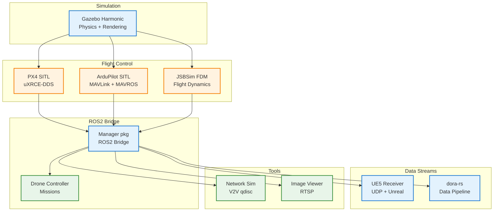

# RealGazebo-ROS2

Multi-vehicle simulation framework integrating **Gazebo Harmonic**, **ROS2 Jazzy**, **PX4 SITL**, **ArduPilot SITL**, **JSBSim**, **Unreal Engine 5**, and **dora-rs**.

[](https://github.com/vlordier/RealGazebo-ROS2/actions)
[](LICENSE)

## Overview

A production-grade simulation platform for multi-vehicle UAV research, bridging Gazebo physics with ROS2 middleware and supporting multiple flight stack backends.

## Key Features

- **Multi-Vehicle Support** — PX4, ArduPilot, and JSBSim in a single simulation
- **ROS2 Jazzy + Gazebo Harmonic** — Latest LTS stack, containerized for reproducibility
- **UE5 Integration** — Real-time pose/motor data streaming to Unreal Engine 5
- **dora-rs Data Pipeline** — Pydantic-validated dataflow for real-time analytics
- **Automated CI/CD** — Docker build, smoke tests, and documentation deployment

## Architecture



## Quick Start

```bash
# One-command setup and run (recommended)
bash scripts/quickstart.sh

# Or step by step:
make setup          # Install dev tools + pre-commit hooks
make build          # Build base Docker image
make up             # Start simulation
make test           # Run all tests
make smoke-test     # Verify system is healthy
```

## Vehicle Config

```yaml
vehicles:
  0:
    type: x500
    firmware: px4        # px4, ardupilot, or jsbsim
    build_target: 0
    spawnpoint: (0, 0, 0, 0)
```

## Packages

| Package | Language | Purpose |
|---------|----------|---------|
| `realgazebo` | C++ | Gazebo plugins, SDF models, launch files |
| `manager` | Python | PX4 ROS2 bridge, keyboard controller |
| `drone_controller` | Python | Autonomous mission execution |
| `image_viewer` | Python | RTSP camera stream viewer |
| `network_sim` | C++ | V2V communication simulation (TC qdisc) |
| `jsbsim_bridge` | Python | JSBSim flight dynamics ROS2 bridge |
| `ardupilot_bridge` | Python | ArduPilot MAVROS ROS2 bridge |

## Requirements

- **ROS2 Jazzy** + **Gazebo Harmonic** (Ubuntu 24.04)
- Python 3.10+ (3.12 recommended)
- Docker with Buildx
- **macOS**: `brew install --cask xquartz` + `xhost +localhost` for GUI

## Developer

```bash
make test        # Run all Python tests
make lint        # Run ruff linter
make up-dev      # Start with hot-reload
make clean       # Remove build artifacts
```

## License

GPL-3.0-only. See [LICENSE](LICENSE).
